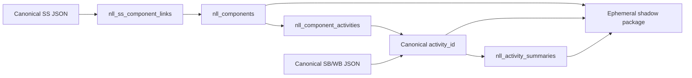

# Neutral Lesson Library Pilot Architecture

**Status:** ACTIVE / DEVELOPMENT
**Version:** 0.1
**Date:** 2026-10-29
**Scope:** Big English 3 Unit 8 Opener only

## Founding principle

**A modular, additive knowledge library built on a trusted curriculum foundation.**

**The foundation guides. The library grows. Individual knowledge improves. Everything else keeps working.**

*Beauty in simplicity.*

SS + SB + WB remain the trusted curriculum foundation, not the ceiling. NLL knowledge must retain a meaningful connection to that foundation while remaining independently replaceable. Canonical publisher content is referenced, never copied into NLL records.

## Implemented locally

Migration `20261029120000_create_nll_pilot.sql` defines:

- `nll_components`: reusable lesson components;
- `nll_component_activities`: component membership by stable canonical `activity_id`;
- `nll_activity_summaries`: independently versioned summaries keyed directly to `activity_id`;
- `nll_ss_component_links`: exact component-level SS locators.

The bounded seed contains one `be3-u08-opener` component, nine activity memberships, nine hidden experimental summaries, and two proposed SS links. Source bindings use the authoritative remote SB/WB object hashes and stable per-activity fingerprints.

The migration is applied on Supabase project `kivvmobjphtcgxoltqbc`. Persistent seed counts, retrieval, proposed-SS boundary, RLS, and unchanged remote SB/WB/SS object hashes were verified on 2026-10-29.

## Relationships

Summaries do not reference lesson components. Multiple components can reuse the same activity summary. Promoting a new preferred summary changes summary rows only; component membership remains unchanged.

## Retrieval and shadow behavior

The read-only retrieval service loads a component by stable key, resolves ordered canonical activity identities, returns preferred eligible summaries, excludes hidden records by default, and permits them only through an explicit shadow option. It reports `current`, `potentially_stale`, or `unverifiable` by comparing activity fingerprints and separates available SS authority links from proposed links.

The experimental package builder is controlled by `VITE_CHALKIE_NLL_SHADOW_PILOT`, which is absent/default-off. It includes selected activities only, keeps publisher evidence separate from AI summaries, and never treats proposed SS links as approved curriculum authority.

## Pilot records

| Record type | Count | State |
|---|---:|---|
| Components | 1 | `draft` |
| Component activities | 9 | Five SB + four WB |
| Activity summaries | 9 | `hidden` + `experimental`; v1 preferred |
| SS component links | 2 | `proposed` |

## Boundaries

This pilot does not change canonical SS/SB/WB JSON, production lesson generation, teacher workflows, existing package builders, activity selection, prompt generation, or deployment. It does not implement horizontal progression, teacher editing, persistent selections/packages, multi-school ownership, or activity-level SS claims.

## Verification

- New focused NLL tests: 7 passed.
- App TypeScript validation: passed.
- Existing Scope & Sequence regression suite: passed.
- Existing WB-dependent local suites remain unable to start on this work PC because the local BE3 WB canonical file is absent; the authoritative remote WB object was read and hash-verified without creating a local replacement.

## Approved completion handover

D025 completion actions are done: migration applied, persistence/RLS verified, and the pilot committed on `main`. Feature development is frozen. The next milestone is a read-only **Project Consolidation & Repository Audit**. Production exposure, teacher-facing visibility, summary promotion, and deployment remain outside this pilot.
