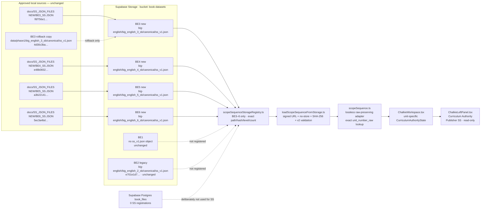
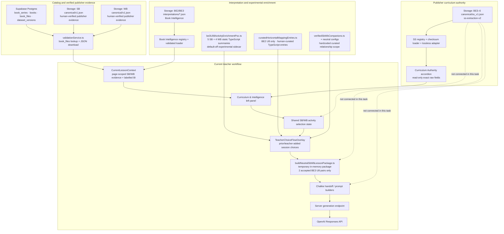
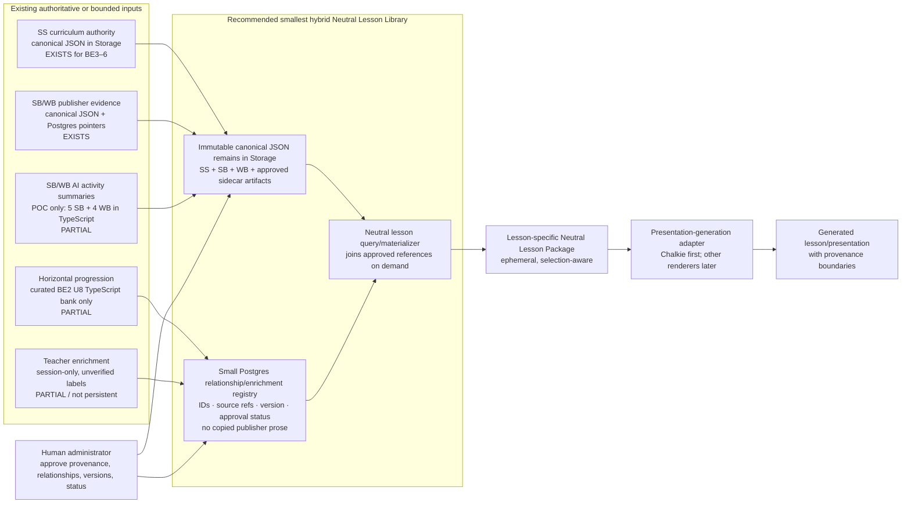

# BE3–6 Scope & Sequence runtime integration and architecture audit

**Date:** 2026-10-28

**Pre-closeout status:** Live Storage migration complete; local application integration complete and verified; at the time this audit was recorded, application code had **not yet been committed, pushed, or deployed**.
**Authority:** User-approved controlled implementation for the four BE3–6 SS objects only.

**Record note:** This document preserves the evidence and state immediately before the separately approved commit/push/deploy closeout. The final commit hash, deployment result, and authenticated smoke-test evidence belong to that closeout record rather than being predicted here.

## Executive control statement

The approved `ss-extraction-v2` documents for Big English 3–6 now occupy the four authorized Supabase Storage paths, byte-for-byte matching the approved local source files. The local application has a small, checksum-pinned SS registry, a lossless loader/adapter, exact unit-number resolution, and a distinct read-only **Curriculum Authority** section.

At this pre-closeout audit point, the production application was not yet running the new code because deployment required separate approval. This report therefore distinguishes:

1. **Storage migration:** complete in live Supabase Storage.
2. **SS-first application integration:** complete and verified locally; production activation was pending separate closeout approval.

The audit corrected one important starting assumption: before this change, the application did **not** load or display any Scope & Sequence artifact. Legacy BE2 and BE3 SS objects existed as unregistered Storage companions; BE1 and BE4–6 had no SS object at the expected path. Runtime SB/WB evidence came from `canonical/v1.json`, not from SS.

No BE1–2 SS, SB/WB canonical dataset, activity-summary record, teacher-selection logic, prompt-generation module, database record, or deployment was changed.

---

## A. SS migration summary

| Book | Result | Runtime state |
|---|---|---|
| BE1 | Unchanged; no SS object was present at the expected Storage path | Intentionally absent from the new registry |
| BE2 | Unchanged legacy `ss_v1.json` | Intentionally absent from the new registry |
| BE3 | Legacy SS object replaced with approved `BE3_SS.JSON`; old bytes preserved locally for rollback | Wired into local app; deployment pending |
| BE4 | Approved `BE4_SS.JSON` added to previously empty SS path | Wired into local app; deployment pending |
| BE5 | Approved `BE5_SS.JSON` added to previously empty SS path | Wired into local app; deployment pending |
| BE6 | Approved `BE6_SS.JSON` added to previously empty SS path | Wired into local app; deployment pending |

### Approved source inventory

The request referred to `docs/ss_json_files_new/`; the actual supplied directory is `docs/SS_JSON_FILES NEW/`. The files below were read without modification.

| File | Target | Schema / prompt | Units | Publisher categories | Source metadata | QA summary | SHA-256 |
|---|---|---|---:|---|---|---|---|
| `docs/SS_JSON_FILES NEW/BE3_SS.JSON` | Big English 3 | `ss-extraction-v2` / `SS-V2` | 9 | Vocabulary; Structures; CLIL/Culture; Writing; Phonics; Values; I can... | `BE3_SS.PDF`; Pearson; Big English; level `3` | all columns, row alignment, and second visual pass checked; 0 issues | `f6f756e15becb1fd7aea2f172bdcacc043a520aeee81813472561cc877d6bb5a` |
| `docs/SS_JSON_FILES NEW/BE4_SS.JSON` | Big English 4 | `ss-extraction-v2` / `SS-V2` | 9 | Vocabulary; Structures; CLIL/Culture; Writing; Phonics; Values; I can... | `BE4_SS.pdf`; Pearson; Big English; level `4` | same checks; 0 issues | `e48b0832ec1ac1e2aafa690a69900ecf6b2a50aaed54946d02f6daf3fee354ce` |
| `docs/SS_JSON_FILES NEW/BE5_SS.JSON` | Big English 5 | `ss-extraction-v2` / `SS-V2` | 9 | Vocabulary; Structures; CLIL/Culture; Writing; Life Skills/Project; Phonics; I can... | `BE5_SS.PDF`; Pearson; Big English; level `Big English 5` | same checks; 0 issues | `a3b221412a765b5e2f323d86b67df1163b71b534dcdb1ac7fe19e231af8128c5` |
| `docs/SS_JSON_FILES NEW/BE6_SS.JSON` | Big English 6 | `ss-extraction-v2` / `SS-V2` | 9 | Vocabulary; Structures; CLIL/Culture; Writing; Life Skills/Project; Phonics; I can... | `BE6_SS.PDF`; Pearson; Big English; level `6` | same checks; 0 issues | `5ec3a4bd6e93380db0d796e49d63e5551f4ead859876de3570dfdfeafbd4d746` |

All four files report `visible_unit_count = extracted_unit_count = 9`, `all_columns_checked = true`, `row_alignment_checked = true`, `second_visual_transcription_pass_completed = true`, and zero total/unresolved extraction issues. Their computed hashes are the migration audit hashes used by the registry and post-upload verification.

### Compatibility finding

The legacy BE3 object and approved v2 document are not structurally compatible:

| Area | Legacy object | Approved v2 object |
|---|---|---|
| Root | No declared schema version; `checkpoints` | `schema_version`, `extraction_metadata`, `checkpoints_and_reviews`, `back_matter`, `qa_summary` |
| Unit identity | `unit_number`, `unit_title`, `student_book_pages`, `source_pages` | `unit_number_raw`, `unit_title_raw`, `student_book_pages_raw`, `source_location` |
| Category | `category_name` plus interpreted `content` object | `category_name_raw`, `column_order`, `cell_status`, exact `raw_text`, `content_blocks` |

No old app logic depended on the legacy schema because no SS loader or SS UI consumer existed. The new adapter therefore projects only the exact fields needed for display and retains the complete original document, unit, and category objects under `raw`. It does not rewrite the approved JSON, drop categories, or infer curriculum relationships.

---

## B. Before-and-after comparison

| Book | Previous SS | Current SS | Runtime verified? |
|---|---|---|---|
| BE1 | No object at `book-datasets/big-english/big_english_1_sb/canonical/ss_v1.json`; no runtime SS consumer | Unchanged; no registry entry | Preservation verified; no SS display expected |
| BE2 | Legacy unregistered Storage companion, SHA-256 `e701e1d784beffea84ebbf0dd7a24ab0265bdfe3c575d073b699ae0d19c7a918`; not consumed | Unchanged; no registry entry | Object hash verified; existing workflows covered by regressions |
| BE3 | Legacy unregistered Storage companion, SHA-256 `4d30c3bae33283262156822b794bebfe1ba545c7fd5a484bbacb9e8135305bd5`; not consumed | New approved v2, SHA-256 `f6f756e15becb1fd7aea2f172bdcacc043a520aeee81813472561cc877d6bb5a` | Live download + local runtime/component render verified |
| BE4 | No SS object; no runtime SS consumer | New approved v2, SHA-256 `e48b0832ec1ac1e2aafa690a69900ecf6b2a50aaed54946d02f6daf3fee354ce` | Live download + local runtime/component render verified |
| BE5 | No SS object; no runtime SS consumer | New approved v2, SHA-256 `a3b221412a765b5e2f323d86b67df1163b71b534dcdb1ac7fe19e231af8128c5` | Live download + local runtime/component render verified |
| BE6 | No SS object; no runtime SS consumer | New approved v2, SHA-256 `5ec3a4bd6e93380db0d796e49d63e5551f4ead859876de3570dfdfeafbd4d746` | Live download + local runtime/component render verified |

“Runtime verified” means that the live object was fetched through a fresh signed URL, its bytes matched the pinned hash, the v2 parser accepted it, and the real `ChalkieLeftPanel` component rendered an exact Unit 1 projection. Production activation remains pending deployment approval.

---

## C. Files and Storage objects changed

### Live Supabase Storage — exactly four authorized objects

Bucket: `book-datasets`

| Object | Action | Bytes | Verified SHA-256 | Storage updated at (UTC) |
|---|---|---:|---|---|
| `big-english/big_english_3_sb/canonical/ss_v1.json` | Replaced legacy object | 44,940 | `f6f756e15becb1fd7aea2f172bdcacc043a520aeee81813472561cc877d6bb5a` | `2026-10-28T15:26:01.831Z` |
| `big-english/big_english_4_sb/canonical/ss_v1.json` | Created | 49,645 | `e48b0832ec1ac1e2aafa690a69900ecf6b2a50aaed54946d02f6daf3fee354ce` | `2026-10-28T15:26:58.586Z` |
| `big-english/big_english_5_sb/canonical/ss_v1.json` | Created | 48,477 | `a3b221412a765b5e2f323d86b67df1163b71b534dcdb1ac7fe19e231af8128c5` | `2026-10-28T15:26:59.152Z` |
| `big-english/big_english_6_sb/canonical/ss_v1.json` | Created | 55,570 | `5ec3a4bd6e93380db0d796e49d63e5551f4ead859876de3570dfdfeafbd4d746` | `2026-10-28T15:26:59.575Z` |

No Postgres row was added or modified. A post-change query found **zero** `book_files` rows ending in `/ss_v1.json`. Registration is deliberately a small application-side registry, matching the existing Book Intelligence companion pattern.

### Rollback artifact

The legacy BE3 bytes are preserved at:

`data/phase1/big_english_3_sb/canonical/ss_v1.json`

- Size: 29,314 bytes
- SHA-256: `4d30c3bae33283262156822b794bebfe1ba545c7fd5a484bbacb9e8135305bd5`
- This exactly matches the pre-replacement live BE3 object.

No legacy BE4–6 object existed to back up. Creating additional backup Storage objects would have exceeded the authorization of exactly four SS objects, so no unnecessary duplicates were introduced.

### Local application files

| File | Change |
|---|---|
| `app/src/features/scope-sequence/scopeSequence.ts` | New strict v2 types/parser, raw-object retention, and exact unit-number lookup |
| `app/src/features/scope-sequence/scopeSequenceStorageRegistry.ts` | New four-entry BE3–6 Storage registry with pinned hashes, target levels, paths, and unit counts; BE1–2 absent by design |
| `app/src/features/scope-sequence/loadScopeSequenceFromStorage.ts` | New signed-URL loader with cache busting, `no-store`, SHA-256 verification, schema/series/level/unit checks, and fail-closed results |
| `app/src/features/chalkie/ChalkieWorkspace.tsx` | Loads SS independently and derives a unit-specific `CurriculumAuthorityState`; no prompt/package plumbing |
| `app/src/features/chalkie/ChalkieLeftPanel.tsx` | Adds the distinct read-only green `Curriculum Authority` accordion and displays exact raw category text |
| `scripts/tests/scopeSequenceRuntime.test.ts` | Adds registry, hash, parsing, losslessness, unit lookup, missing-data, and display-only boundary tests |
| `docs/project-tracking/ss-canonical-v1-runtime-integration-audit-2026-10-28.md` | This audit, architecture, verification, and rollback record |

The user-supplied `docs/SS_JSON_FILES NEW/` files remain unchanged and untracked. No application files have been committed, pushed, or deployed.

### Protected canonical datasets

All 12 live BE1–6 SB/WB `canonical/v1.json` objects were re-downloaded with cache-busted signed URLs after the SS migration. Every SHA-256 remained identical to the pre-change audit:

| Object | SHA-256 | Result |
|---|---|---|
| `big_english_1_sb/canonical/v1.json` | `201d05711a986e9768b61a13a3b08360e8a51ac656352f373e5054045275bba6` | Unchanged |
| `big_english_1_wb/canonical/v1.json` | `51647aa978e37d964ba42a61ae118d7c4ca702671853e63c88226d922ba8f36b` | Unchanged |
| `big_english_2_sb/canonical/v1.json` | `b68642ebccb4d43da0b5114b7a51ee4027515c6b0648adce516ef1f1a7505cfa` | Unchanged |
| `big_english_2_wb/canonical/v1.json` | `5950ee2b73a0fee0984acdfb3eb88a828021d9ce3113e0af3c02d72e567686cf` | Unchanged |
| `big_english_3_sb/canonical/v1.json` | `3924fa23e6a70d9bb5af139544915a8954b5f1d5b8bdd3833f9aa834911b67e6` | Unchanged |
| `big_english_3_wb/canonical/v1.json` | `811deea2e5b04bef2a0c0223d5d75ffe94218bfb5aecc58a1898ecabf43504fa` | Unchanged |
| `big_english_4_sb/canonical/v1.json` | `d4858348ef5fc9d5f6e7f85224092faf4e6693910d1575e8572a5d6808a39142` | Unchanged |
| `big_english_4_wb/canonical/v1.json` | `d658fb69b3fc577f10c18606f31a3f4242c103523523ec3f16e0b8f8f46df608` | Unchanged |
| `big_english_5_sb/canonical/v1.json` | `7e887c040cc8a7c0aa580fe8abb969bc2d760e20f665145d2a2470f87da3a362` | Unchanged |
| `big_english_5_wb/canonical/v1.json` | `1207a58ead32c3b27b137e7ec31f30b82dd882d9576d853da4e65652a07e0ec5` | Unchanged |
| `big_english_6_sb/canonical/v1.json` | `42ab1c58f3e45c00956f5f5f72d83e18fddbe616d1977efe97b53d75580338a2` | Unchanged |
| `big_english_6_wb/canonical/v1.json` | `d2841c7f2f3b273faa456927a33230fbf1fa0c8ba8a5953ed36b12a3efd64578` | Unchanged |

### Rollback instructions

No rollback was performed.

1. **BE3 Storage rollback:** upload the preserved 29,314-byte file at `data/phase1/big_english_3_sb/canonical/ss_v1.json` back to `book-datasets/big-english/big_english_3_sb/canonical/ss_v1.json` with upsert enabled. Fetch it through a new/cache-busted signed URL and require SHA-256 `4d30c3bae33283262156822b794bebfe1ba545c7fd5a484bbacb9e8135305bd5`.
2. **BE4–6 Storage rollback:** these objects did not exist before the migration. Rolling them back means deleting exactly their three `ss_v1.json` objects. This is destructive and must not be done without explicit approval.
3. **Application rollback:** no deployed code exists to roll back. Before any deployment, remove or revert only the two modified files, the three new `scope-sequence` files, and the SS test after checking for overlapping human edits. Do not use a broad reset.
4. **BE1–2 and canonical evidence:** no action; they were not changed.

Because the code registry pins the new hashes, restoring old BE3 bytes while deploying the new registry would correctly fail closed and show an unavailable notice rather than present unverified data.

---

## D. Validation results

### Data and Storage checks

| Check | Result |
|---|---|
| Four source files parse as JSON | PASS |
| Schema `ss-extraction-v2`, prompt `SS-V2`, correct target level | PASS |
| Nine ordered units in each document | PASS |
| All publisher categories retained by adapter | PASS |
| Adapter retains complete source document/unit/category under `raw` | PASS |
| Source hashes equal registry/audit hashes | PASS |
| Four live Storage downloads equal approved source hashes | PASS |
| Four live objects report v2 schema and nine units | PASS |
| BE1 remains absent at expected SS path | PASS |
| BE2 legacy SS hash unchanged | PASS |
| No SS `book_files` rows created | PASS |
| All 12 protected SB/WB canonical hashes unchanged | PASS |
| Legacy BE3 rollback file equals pre-change object | PASS |

The first normal Supabase download immediately after overwrite returned a cached legacy BE3 response even though Storage metadata showed the new object. The production loader therefore uses a short-lived signed URL, appends the pinned checksum as a cache-busting query, requests `cache: 'no-store'`, and verifies the downloaded bytes before parsing. Fresh signed-download verification then passed for all four books.

### Exact displayed-field provenance

For every book below, the real `ChalkieLeftPanel` was server-rendered with the approved document and canonical Unit 1 context. The test required the read-only badge, exact title, exact page string, every category name, and every category `raw_text` to appear. All categories passed. One exact field trace per book is recorded here:

| Book / displayed unit | Approved JSON field | Exact displayed value | Result |
|---|---|---|---|
| BE3 Unit 1, `Wake Up!` | `units[0].publisher_categories[category_name_raw="Vocabulary"].raw_text` | `Daily routines: do my homework, eat breakfast, get dressed, go home, go to school, go to the park, play football, play video games, wake up, watch TV` + newline + `Times: seven fifty-five, seven forty-five, seven thirty, in the afternoon, evening, morning` | PASS |
| BE4 Unit 1, `Kids in My Class` | same exact path predicate | `Appearance: blonde, curly, dark, glasses, light, short, straight, tall, wavy` + newline + `Personality: clever, friendly, funny, serious, shy, heavy` | PASS |
| BE5 Unit 1, `MY INTERESTS` | same exact path predicate | `Activities: act, build robots, do martial arts, draw, jog, paint, play chess, play sports, play the trumpet, write articles` + newline + `Clubs/Teams: art club, athletics team, basketball team, drama club, football team, school newspaper, school orchestra, school play/musical, science club, tae kwon do club` | PASS |
| BE6 Unit 1, `ALL ABOUT SCHOOL` | same exact path predicate | `School Activities: do homework, finish a project, hand in an essay, study for a test` + newline + `Advice: be more careful, do it earlier, do it again, pay attention to the time, take it away from` | PASS |

The unit association uses `Number(unit_number_raw) === Number(currentUnitNumber)`. It does not match or reinterpret unit titles.

### Application and regression checks

| Check | Result |
|---|---|
| New SS runtime tests | PASS — 6/6 |
| Existing activity selection, WB selection, enrichment POC, neutral-package, renderer, and prompt/handoff regressions | PASS — 76/76 |
| Missing SS fail-safe render | PASS — notice shown; Book Content and Book Intelligence still render |
| Structural boundary: only `ChalkieWorkspace.tsx` and `ChalkieLeftPanel.tsx` import the new SS feature from the Chalkie area | PASS |
| TypeScript typecheck | PASS |
| Production build | PASS — 2,133 modules transformed |
| Lint | PASS with zero errors; existing warning classes remain, including `set-state-in-effect` and pre-existing hook/memoization warnings |
| Full signed-in browser click-through | NOT RUN — the in-app browser had no authenticated test session, and creating/changing auth data was outside the authorized four-object Storage scope |
| Commit / push / deploy | NOT PERFORMED |

The direct component render validates the actual UI implementation without bypassing authentication or altering auth/database state. A final signed-in smoke test should accompany a separately approved deployment.

---

## E. Architecture diagrams

### Diagram 1 — Current SS storage and runtime flow

### Diagram 2 — Curriculum Mapper full current data flow

Solid arrows are implemented. Dashed arrows marked “not connected” are intentionally absent in this task.

The new SS is authoritative in provenance and presentation, but deliberately does not yet control lesson prompts or activities. That second milestone needs explicit design/approval; it must not be implied by the successful Storage/runtime display integration.

### Diagram 3 — Proposed future Neutral Lesson Library

This is a recommendation only; nothing in this diagram was implemented by this task.

Recommended principle: keep publisher source content immutable in versioned JSON/Storage; add only small, approved relational records for relationships, enrichment, provenance, and lifecycle state. Materialize a lesson package on demand rather than persisting duplicate lesson documents prematurely.

---

## F. Neutral Lesson Library findings

### Does it currently exist?

No persistent Neutral Lesson Library exists.

There is no NLL JSON file collection, database table, or general runtime repository. The nearest implementation is `buildNeutralSbWbLessonPackage.ts`, a TypeScript assembler that returns a temporary in-memory `NeutralSbWbLessonPackage` for exactly two curated BE3 Unit 8 relationships:

- Opener: SB pp. 128–129 → WB pp. 104–105
- Story: SB pp. 130–131 → WB p. 106

Unsupported relationships throw rather than fall back. The package is selection-aware and is passed to bounded rendering adapters/canaries; it is not stored as a reusable library record. Therefore the NLL remains an architectural concept with a narrow package prototype, not an implemented library.

### Current storage by information layer

| Layer | Current physical storage | Used by app? |
|---|---|---|
| SS requirements | Live Supabase Storage `book-datasets/.../canonical/ss_v1.json`; local approved source files; BE3 rollback copy; local four-entry app registry | Yes in the new local implementation for BE3–6; deployment pending. BE1–2 intentionally not registered |
| SB evidence | Supabase Storage `book-datasets/big-english/<sb-id>/canonical/v1.json`; Postgres `book_files`/`dataset_versions`; gitignored local `data/phase1/...` working copies | Yes — Validation, Chalkie evidence, activity cards, selection, handoff |
| WB evidence | Same canonical Storage/Postgres/local pattern under WB catalog IDs | Yes when a verified companion relationship resolves |
| SB/WB AI activity summaries | Static TypeScript sidecars in `be3U08ActivityEnrichmentPoc.ts` — five SB and four WB records | Yes only in the bounded default-off POC path |
| Book Intelligence (distinct from activity summaries) | Draft JSON companions in Supabase Storage `interpretations/`; local Phase 2 artifacts; static app registry | Yes for BE2/BE3 as labelled unit-level interpretation |
| Horizontal progression | Static TypeScript `curatedHorizontalMappingEntries.ts`; only the verified BE2 U8 pp. 128–129 bank | Yes in the bounded Step 2 candidate flow; not a general progression layer |
| Teacher enrichment | React state in `TeacherChoiceFlowOverlay.tsx`; IDs created for the current session | Yes during the open workflow only; not persisted |
| Neutral Lesson Package | TypeScript object returned in memory by `buildNeutralSbWbLessonPackage.ts`; bounded opener/story renderers and canaries | Yes for the two accepted BE3 U8 pairs; not a persistent library |

### Nine activity summaries

The reported POC was located exactly:

- `BE3_U08_ACTIVITY_SUMMARY_SIDECAR`: five SB summary records linked to canonical activity IDs `bep3_sb_act_08_01` through `..._05`.
- `BE3_U08_WB_ACTIVITY_SUMMARY_SIDECAR`: four WB summary records linked to `bep_3_wb_act_104_1`, `...104_2`, `...105_3`, and `...105_4`.
- Both arrays live in `app/src/features/chalkie/be3U08ActivityEnrichmentPoc.ts` as frozen TypeScript constants.
- Each record identifies `sourceEvidence.activityId`, source `SB` or `WB`, `verificationStatus: human_verified`, experimental review status, and AI-assisted generation metadata.
- The WB set is additionally bounded by the exact curated relationship `be3_sb_wb_rel_u08_opener_sb128-129_wb104-105`.
- `buildBe3U08ActivityEnrichmentPocPackage.ts` joins the summaries to verified activity cards; it does not rewrite publisher evidence.
- The feature flag `VITE_CHALKIE_BE3_U08_ACTIVITY_ENRICHMENT_POC` is default-off.

They are persistent only as source-controlled TypeScript declarations. They are not JSON objects, Postgres records, or general library rows. They are instantiated in memory and remain distinct from the older Phase 2 Book Intelligence JSON.

### Simplest suitable future architecture

| Option | Strength | Cost / risk | Fit |
|---|---|---|---|
| JSON-backed library | Simple immutable artifacts and easy hash/version checks | Relationship queries, approvals, partial updates, teacher enrichment, and lifecycle state become awkward; risks proliferating duplicated lesson JSON | Good for canonical sources, insufficient alone for the library |
| Database-backed library | Strong querying, relationships, status, permissions, and updates | Would duplicate large canonical publisher content and create a premature migration/schema surface | Too heavy as the first step |
| Hybrid | Keeps SS/SB/WB and approved sidecars as immutable Storage JSON; stores only IDs, relationships, provenance, version, review status, and enrichment in a small database layer | Requires one carefully bounded relational contract | **Recommended** |

The hybrid option best matches the actual architecture: Storage already owns large canonical/interpretation artifacts, Postgres already owns catalog pointers and verification state, and runtime builders already materialize page/lesson packages. The future database layer should reference canonical IDs and hashes, not copy publisher prose.

No SS-to-activity relationship, new schema, general NLL, or horizontal-progression expansion was implemented.

---

## G. Tool responsibility matrix

| System | Verified current responsibility | Recommended future boundary |
|---|---|---|
| ChatGPT Desktop / Codex | Assisted this code/data audit, controlled four-object migration, local implementation, testing, and report under human approval | Engineering/audit assistant only; may propose and execute approved changes, but never becomes curriculum authority or self-approves destructive/deploy actions |
| Cursor | No runtime or data-governance role is observable in the codebase | Developer editor/review surface only; changes must pass the same tests, provenance rules, and human approval |
| Google AI Studio / Gemini | Project docs define it as the Phase 1 extraction/transcription workflow and contain SS/SB/WB extraction prompts | Draft extraction only; outputs require deterministic validation and human approval before canonical status |
| OpenAI | Server-side lesson/prompt generation; the nine POC activity summaries record OpenAI/GPT-5 generation metadata | Generate labelled interpretations/summaries/presentations from approved inputs; never overwrite or silently reinterpret canonical SS/SB/WB |
| Curriculum Mapper | Resolves catalog and canonical evidence, displays verified SB/WB and labelled BI, manages teacher selections, builds bounded lesson packages; local code now also displays checksum-verified SS as Curriculum Authority | The runtime integration layer: resolve authoritative sources, preserve provenance, expose approved relationships, and fail safely when optional layers are absent |
| Supabase / Storage | Auth; Postgres catalog/metadata; live object storage for canonical SB/WB, SS companions, and BI artifacts | System of record for approved runtime artifacts plus a small relationship/enrichment registry; use version/hash/status controls and least-privilege writes |
| Human administrator | Approves sources, verification status, migration scope, destructive operations, deployment, and rollback | Final authority for curriculum acceptance, relationship approval, version promotion, access, deployment, and incident recovery |

Responsibility chain:

1. AI tools may **extract or enrich drafts**.
2. Deterministic tooling checks structure, hashes, references, and completeness.
3. A human administrator **verifies and promotes** the artifact.
4. Supabase stores the approved runtime object and metadata.
5. Curriculum Mapper **displays and uses only approved, provenance-labelled layers**.

---

## H. Next recommended development step

First obtain separate approval to review/deploy the current SS integration and run one authenticated smoke path for Unit 1 in each of BE3–6. This closes the production-activation milestone without broadening architecture.

After that acceptance, the next small development step should be a **design-only minimal hybrid Neutral Lesson Library contract** using the already accepted BE3 Unit 8 opener as its single fixture. The contract should reference existing canonical IDs/hashes and define provenance, review status, and relationship versioning; it should not create SS-to-activity relationships, a database migration, or a second content copy until separately approved.

---

## Final scope confirmation

- BE3–6 approved SS Storage objects: updated and checksum-verified.
- BE1–2 SS: unchanged.
- SB/WB canonical evidence: unchanged by hash.
- Existing activity summaries, teacher-selection logic, and prompt workflow: unchanged and regression-tested.
- SS content: unchanged; adapter is lossless.
- Curriculum Authority UI: added locally, read-only, separate from evidence and AI.
- Missing SS: non-blocking.
- Neutral Lesson Library, SS-to-activity relationships, and new progression: not implemented.
- Postgres migrations/records: none.
- Commit/push/deploy: none.
